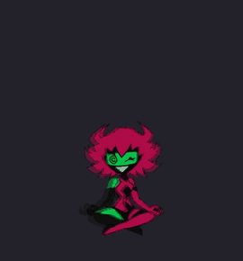
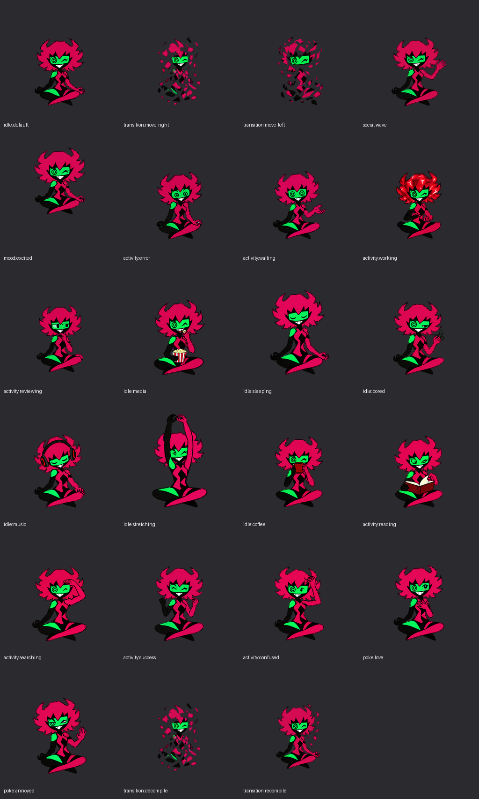

# Capri Desktop

An animated Capri companion for your Windows desktop, with optional local AI chat.
She plays animation loops in place, decompiles around her green eye box to travel,
and reforms into her next expression. No terminal graphics support is needed.



## Features

- Multiple monitors, including negative coordinates and mixed display scaling.
- Continuous animation with authored frame timings and an animation preview menu.
- Hover and poke reactions; personality can shape her gestures and movement.
- Media-screen avoidance and occasional, explicit watch plans with popcorn.
- Local Ollama chat, streamed replies, conversation history and explicit memory notes.
- Optional metadata-only activity events from Codex or your own scripts.

The shared seed prompt is **intentionally empty**. Each user gets a private
`data/persona.txt` to write their own personality. No curated persona, chat history,
memories or personal settings are included.

## Install on Windows

1. Install **Python 3.12, 64-bit**, with the Python launcher or Python on PATH
   ([official Windows downloads](https://www.python.org/downloads/windows/)).
2. Download this repository as a ZIP and extract it, or clone it to a writable folder.
3. Double-click **Setup-Capri.cmd**. It creates a local `.venv` and installs dependencies.
4. Double-click **Start-Capri.cmd**.

PowerShell users can run `./Setup-Capri.ps1` and `./Start-Capri.ps1` instead.
No activation command, administrator account, startup task or terminal image support
is required. The `.cmd` wrappers allow the bundled script for that PowerShell
process only; they do not change the machine's execution policy.

The animation and desktop controls work without an AI model. For chat and
model-driven personality/watch decisions, install and run
[Ollama for Windows](https://docs.ollama.com/windows), then download
the default [qwen2.5:3b model](https://ollama.com/library/qwen2.5:3b) in a terminal:

```powershell
ollama pull qwen2.5:3b
```

Select another installed local model in **Settings** if you prefer. Capri uses
`http://127.0.0.1:11434`; hosted endpoints and recognized cloud models are rejected.
Setup does not download a model. Model inference speed depends on your computer.

## Controls

| Action | Result |
| --- | --- |
| Hover over her visible sprite | Attention animation |
| Click | Poke reaction |
| Double-click | Chat |
| Drag | Move within allowed monitors |
| Right-click | Chat, memories, animation library, media protection and quit |
| Tray icon | Open chat or bring Capri back |

She avoids monitors with detected playing video, fullscreen apps or recognized
game windows. Occasionally, the local model may choose a 30–180 second watch
plan: she perches at an edge with popcorn, then leaves. Windows metadata does
not cover every app; use **Protect media screen** for anything missed. If all
monitors are protected and she is not watching, she hides. Her tray icon remains.

## Make Capri your own

Open **Settings → Edit my seed prompt**, or edit `data/persona.txt` after setup.
Leave it empty for neutral body behavior. See [customization](docs/customization.md).

Chats, explicit memories, settings, the local seed prompt and logs live in `data/`.
That folder is ignored by Git. See [privacy and data](docs/privacy.md).

## Integrations and development

- [Codex and other software events](docs/integrations.md)
- [Development, tests and release checks](docs/development.md)
- [Credits and artwork licensing status](ASSETS.md)
- [Contributing](CONTRIBUTING.md)



Windows is the supported and tested desktop target. Media detection depends on
Windows playback APIs. Other platforms and live directional gaze are not claimed
by this release. This is a source-checkout application; there is no bundled installer.

Original code is under the [MIT license](LICENSE). Artwork is excluded from that
license; its attribution and unresolved licensing details are recorded in [ASSETS.md](ASSETS.md).
